# Day n’ Night 

## Info
Location: 서울시 용산구 소월로 20길 64, 3층 (3F)
Time : 18:30  11:30
Pictures
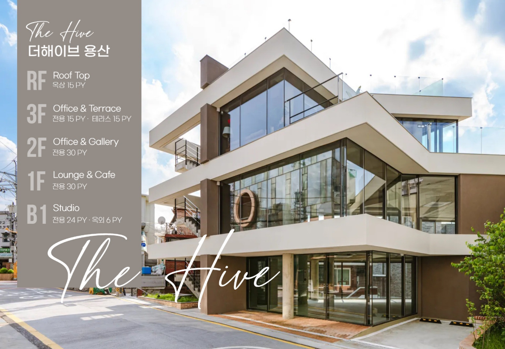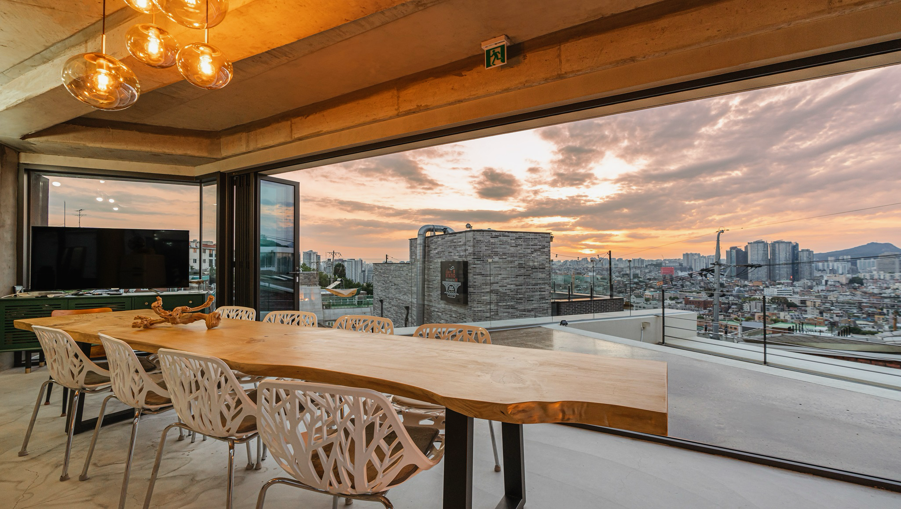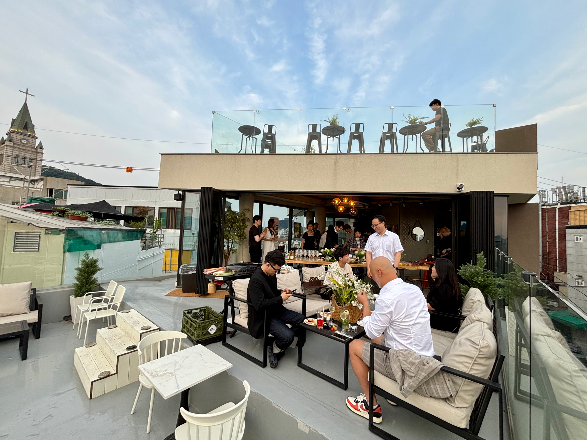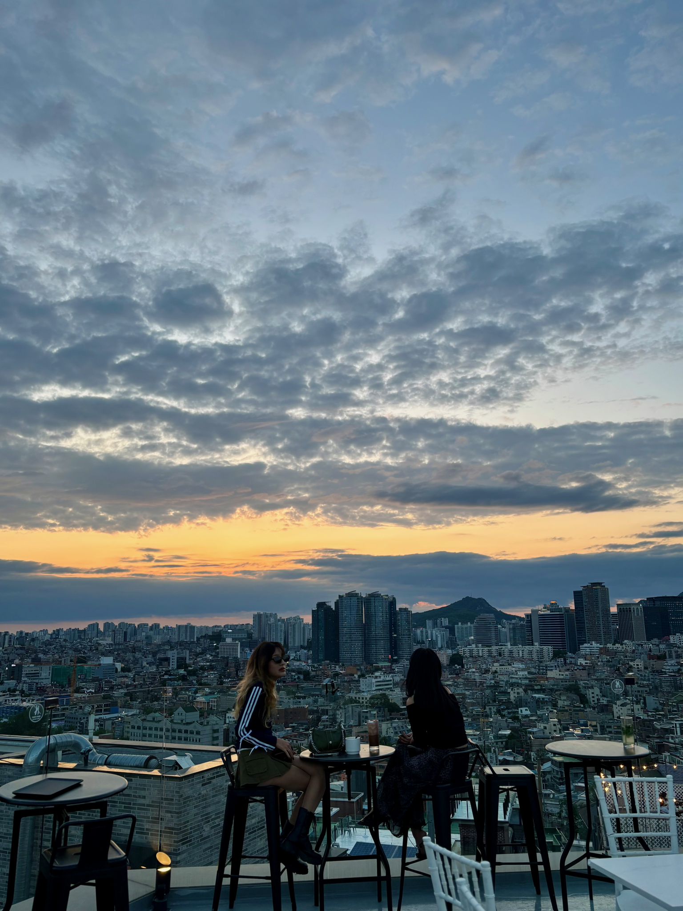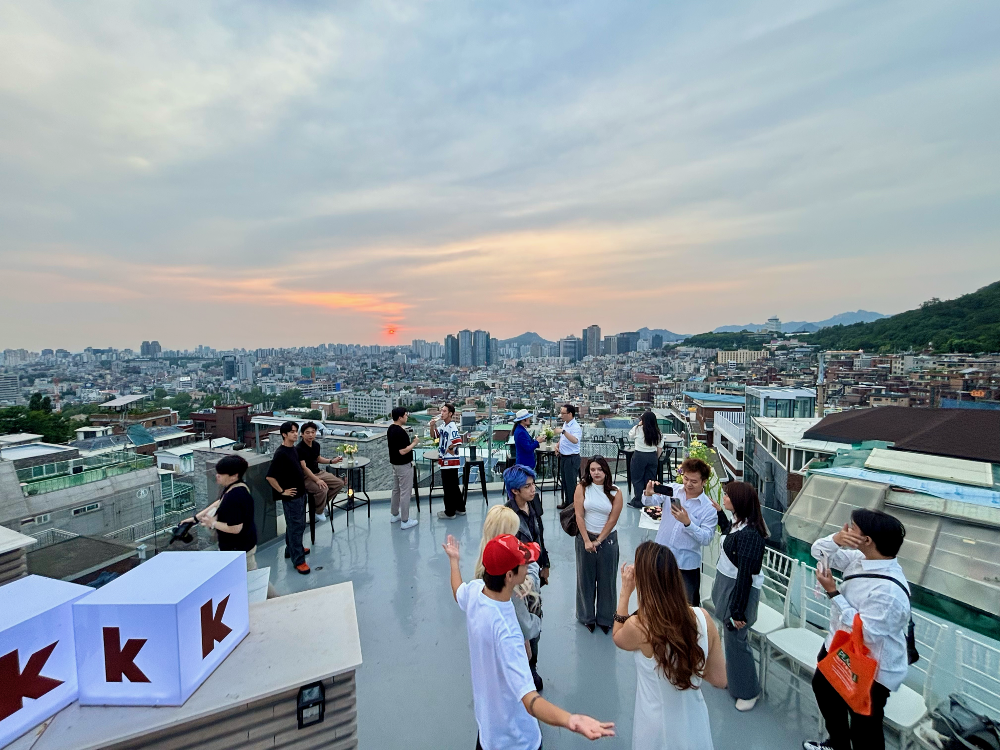
Price 65,000KRW All-Inclusive (Barbecue, Beer, Wine & more )

# Daytime.
## Intro
> 30 & Smokin’
 Fire doesn’t ask permission to burn.
Neither did we. 

 A decade of chasing, stumbling, and figuring it out and somehow, we made it to the other side still standing, still hungry. The smoke rising off this grill isn’t just heat.

 It’s everything we survived,  shed, and done apologizing for.

We’re turning 30 looking every bit as good - come and join the scenery.

## Catering
>  Food and drinks included.
We are grilling- we have the full spread:
Smash burgers
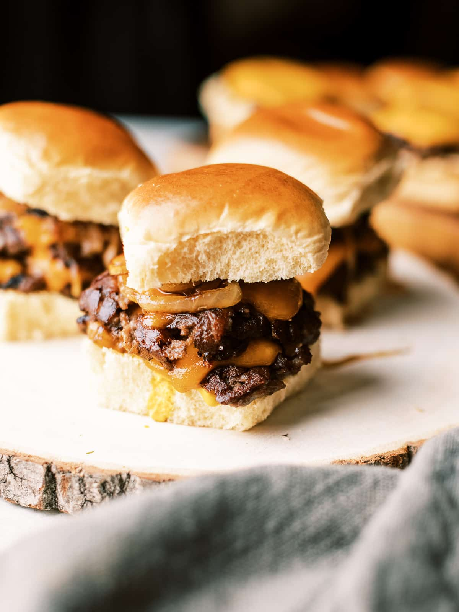

Pork brine
Potatoes… and more.
Backyard cookouts are good ; rooftop barbecues are better.
* barbecue operated from 18:30  20:00; subject to change.
Beer, wine… Gin anyone?

## Dresscode
> Dress for your age… Direction goes both ways.
Standing at the edge of a chapter in life - where one is coming to a close and another to begin - and there’s much to look forward to, as much as look back and cherish. Dress the part. 

Two choices:
> That outfit you still love… but will be too old for soon
Last call: wear ‘em, no apologies. We’ll get you some great photos too. Any outfits welcome:          all geeks, nerds and civilians as much as the next emo girl.
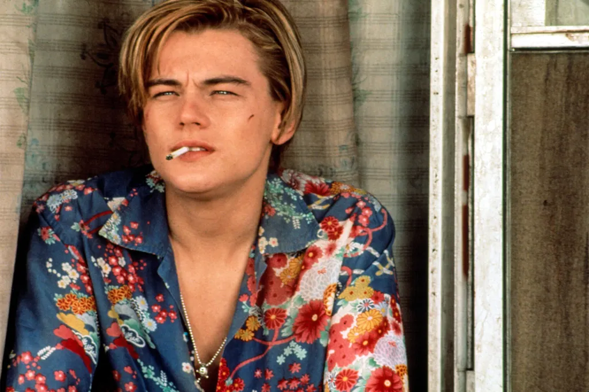
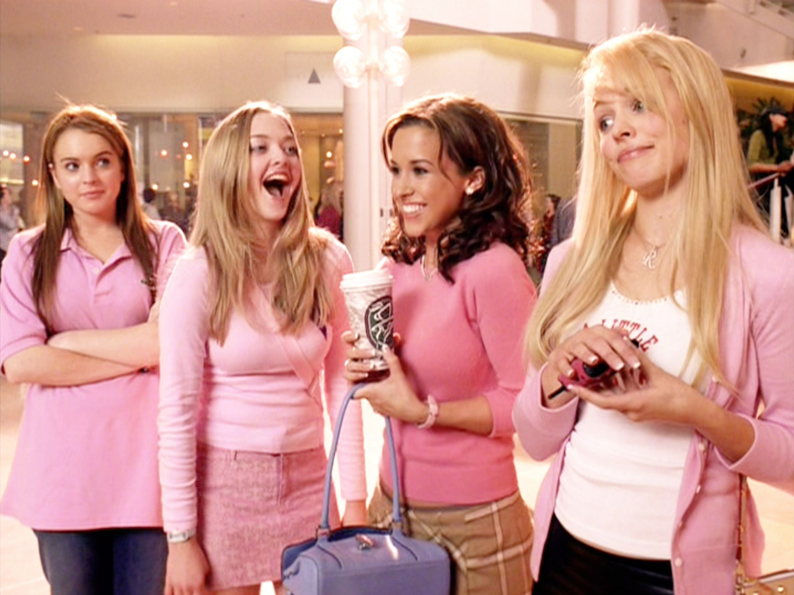

> Daytime unshaven. Nighttime shaken… not stirred
- If you don’t feel #1, here’s the other choice: one outfit to rule ‘em all - the _backyard grilling_AND the _cocktail party dad/mom.
Daytime, you’re an embodiment of _relaxation_.
Retiree in your Malibu senior living - unbothered, uncaring, content in your dad jeans.
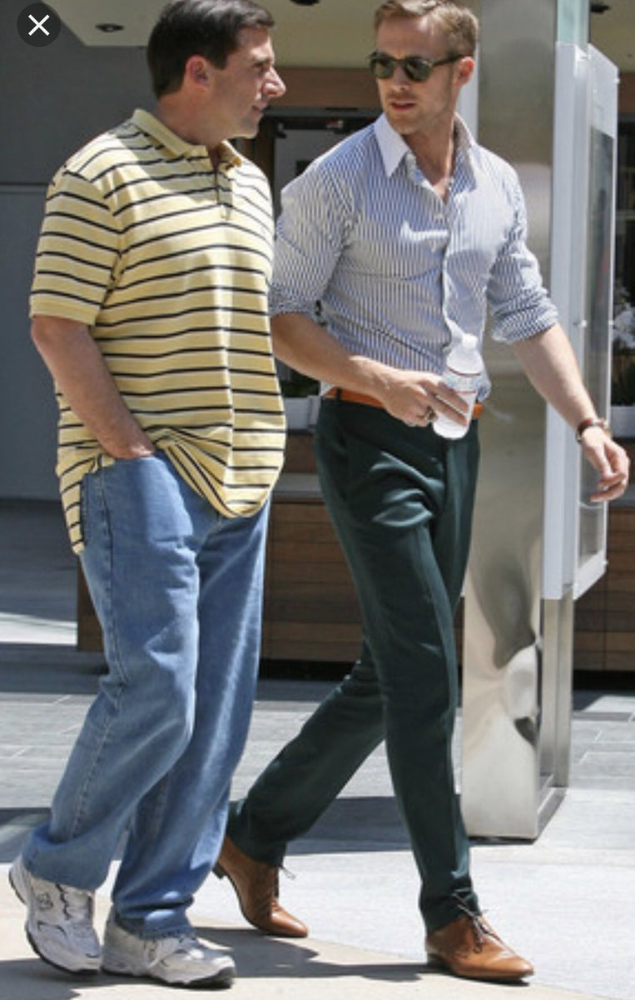
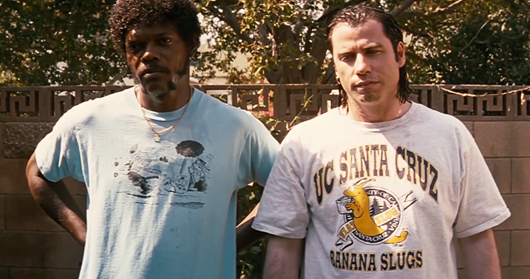
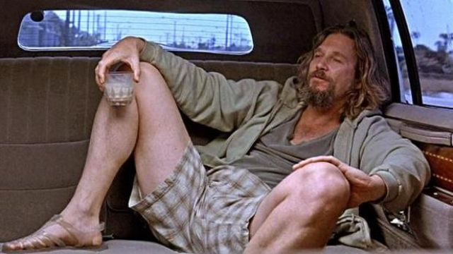

# Nighttime.
Night.
Sharp. Chic. Dressed to impress. 
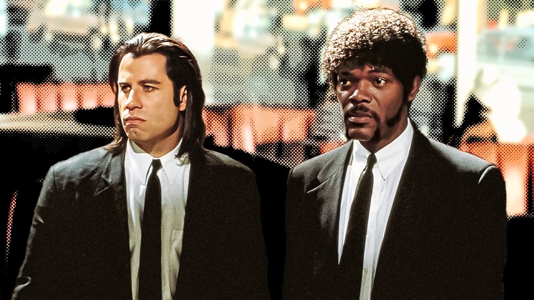

> Charred, Scarred & Thriving

 There’s a particular kind of wisdom that only comes from burning.
Not the kind you read about the kind you live through.

 The friendships that forged us. The losses that hollowed us out and left room for something better.

 The nights we won’t talk about and the ones we’ll never stop telling. 
 We are not who we were at 20; we are the epilogues, the sequels, and spinoffs.
 Charred at the edges, yes, but that’s where the flavor is.
 Pull up a chair. The fire’s been waiting.

> More to come.
 A special surprise coming up- we won’t disappoint.